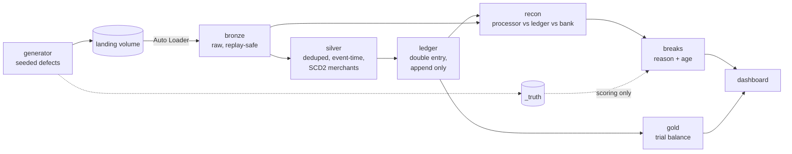

# payments-ledger-recon


Money moves through three systems that disagree. This platform works out which
one is right, every day, and gives a reason for every difference.

It is a double-entry payments ledger with daily three-way reconciliation
(processor, ledger, bank), built on Databricks. The inputs are synthetic, and
every defect in them is planted on purpose, so the pipeline can be scored on
what it catches and what it misses.

**Status:** weekend 1 of 4. The generator and its tests are done. The pipeline
layers are being built. See [Roadmap](#roadmap).

## The problem

A payment facilitator takes card payments for its merchants through an external
processor. The processor deducts fees, nets refunds and chargebacks, and pays
the rest into the facilitator's bank account a day or two later.

Each system tells part of the story, and each gets something wrong:

- **Processor webhooks** arrive twice, late, out of order, and occasionally not at all.
- **Bank statements** settle late, drop references, deduct small charges and convert currency at their own rate.
- **The merchant master** reports fee changes after they have already taken effect.

Finance can't close the day until every rupee is explained. This project is the
system that explains it.

## Architecture



Stack: Databricks Free Edition (serverless), Delta Lake, Auto Loader, Unity
Catalog, Databricks Workflows, Asset Bundles. Python and SQL. The generator is
plain Python with no dependencies.

## What it guarantees

1. Debits equal credits, per currency, per day and overall.
2. Every journal entry balances on its own.
3. Loading the same file twice changes nothing.
4. Rebuilding 30 days from scratch gives the same answer.
5. Every bank line is either matched or listed as a break with a reason.

Each of these is a test in [`tests/test_invariants.py`](tests/test_invariants.py).
They start skipped and are switched on as each layer lands.

## The data

| Source | Format | Arrives |
|---|---|---|
| Processor events | JSON lines | 4 files a day, cut by delivery time |
| Bank statements | CSV | business days only |
| Merchant master | CSV | full snapshot every day |
| FX rates | CSV | business days only |

Default run: 30 days, 25 merchants, about 4,100 payment activities, 700
statement lines, 14 types of planted defect. Full schemas are in
[docs/data-contracts.md](docs/data-contracts.md). The defect list is in
[docs/defects.md](docs/defects.md).

## Run it

Python 3.11+. On Windows PowerShell:

```powershell
py -3.11 -m venv .venv
.venv\Scripts\Activate.ps1
python -m pip install -e ".[dev]"

# Generate all 30 days into .\data (same seed, same bytes, every time)
python -m ledger_recon.generator generate --out data

# Release files up to a date into .\data\inbox, to replay arrivals day by day
python -m ledger_recon.generator release --data data --through 2026-10-07

python -m pytest
```

On Databricks:

```powershell
databricks auth login --host https://<your-workspace>.cloud.databricks.com
databricks bundle deploy -t dev
# Run pipelines/00_setup.sql once in the workspace (creates schema and volumes)
databricks fs cp -r data\inbox dbfs:/Volumes/workspace/ledger_recon/landing --overwrite
databricks bundle run daily_recon
```

Release a few more days, upload again, run the job again. That is how late
data and incremental loads get tested.

## Repo layout

```
src/ledger_recon/generator/   synthetic sources and ground truth
pipelines/                    Databricks notebooks, one per layer
resources/                    job definitions for the bundle
tests/                        generator tests and the invariant scoreboard
docs/                         design, data contracts, defect catalogue
```

## Design decisions

Filled in as they are made. Each one: what I chose, what I rejected, and why.
The open questions are in [docs/design.md](docs/design.md#decisions-to-make-and-defend).

1. Dedup key: _pending_
2. Handling late data: _pending_
3. SCD2 effective dates: _pending_
4. Matching tolerance: _pending_

## Results

Filled in after weekend 4: planted vs caught, by defect type.

| Defect type | Planted | Caught | Missed | Why missed |
|---|---|---|---|---|
| _pending_ | | | | |

## Roadmap

Four weekends, hard cap. Whatever exists at the end of weekend 4 ships.

- [x] Generator with planted defects, ground truth and tests
- [ ] **Weekend 1, ingest:** bronze Delta tables for all four sources, replay-safe
- [ ] **Weekend 2, ledger:** silver dedup and event-time ordering, SCD2 merchants, double-entry postings
- [ ] **Weekend 3, reconcile:** exact, tolerance and many-to-one matching; breaks with reason codes and ageing
- [ ] **Weekend 4, prove it:** trial balance, dashboard, data quality checks, 30-day backfill test, scoring

Stretch, only if v1 ships early: an LLM step that drafts a plain-English
explanation for each break from its lineage.

## License

MIT
